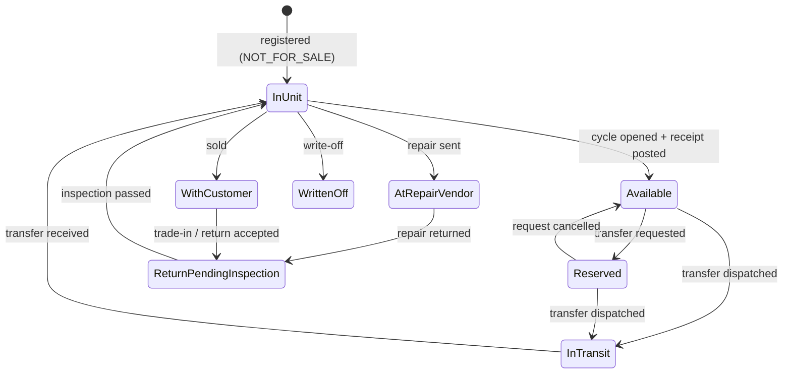

# Mobile Shop ERP — System Architecture

**Version:** 1.3 (POS + installments/exchange/expense/payroll build)
**Status:** living document — Phase 0–2 core plus partial Phase 3–5 implemented
**Companion files:** `docs/ERD.md`, `docs/PERMISSIONS.md`, `docs/PHASE_PLAN.md`, `IMPLEMENTATION_STATUS.md`

---

## 1. Scope and non-negotiables

The product is a single-workspace ERP for a mobile handset shop with Excel-style inventory, lifetime IMEI history, POS, accessories, installments, repairs, exchanges, unit transfers, staff/guest expenses, payroll and double-entry accounting. This repository implements **Phase 0 (foundation)**, **Phase 1 (inventory core)**, the **Phase 2 core** (POS, customers, invoices, receivables, cash/bank/MFS accounts and double-entry journals), plus partial Phase 3–5: installment schedules/reminders, exchange/trade-in, temporary shop delivery, quick expenses and salary/advance ledger. Cashier shifts, returns/refunds, repairs, approval thresholds and the full report suite remain planned and are tracked in `IMPLEMENTATION_STATUS.md`; they are **not** faked in code or UI.

The following invariants drive every design decision:

1. **One physical handset = one persistent identity.** An IMEI (or flagged internal serial) is registered once and never duplicated. A handset can be acquired, sold, traded in, inspected and resold many times under the same identity.
2. **Every state change is an immutable event.** Custody, location, sellability and cost-basis changes append to `inventory_events`. History is never updated or deleted; corrections are new events.
3. **At most one open acquisition cycle per handset.** Enforced by a unique index on `(serialized_unit_id, active_cycle_guard)` where the guard is `1` while open and `NULL` once closed.
4. **Money is decimal, never float.** `DECIMAL(18,2)` in storage; `App\Support\Money` (bcmath) in logic; half-away-from-zero rounding at two decimals.
5. **Cash received ≠ invoice revenue ≠ cost.** Every sale, purchase receipt, opening stock intake, inventory adjustment and due collection posts one balanced journal (debits = credits) with a unique source key; purchases are capitalised, not expensed. Revenue/profit shown in the UI is derived from these posted rows.
6. **Authorization and unit scope are server-side.** Policies and `UnitContext` decide what data can be read or mutated; hidden buttons are never the control.
7. **Posted financial and IMEI data is never hard-deleted.** Purchases can only be cancelled while draft; received purchases are immutable. Handsets, events and cycles have `restrictOnDelete` FKs.
8. **Financial totals are derived, not entered.** Line totals, purchase totals, balances and stock values are computed by services from posted rows.

---

## 2. Runtime stack

| Component | Choice | Notes |
|---|---|---|
| Language | PHP 8.2+ | strict types in all new files; `bcmath` is **required** |
| Framework | Laravel 12.73 | current stable, supports PHP 8.2 |
| UI | Blade + Livewire 3.6 + Alpine.js + Tailwind CSS | server-rendered, no SPA build needed |
| Auth | Laravel session auth (Breeze Blade scaffolding) | public registration disabled |
| RBAC | `spatie/laravel-permission` 6.25 | roles + granular permissions; no "teams" mode |
| Spreadsheets | `phpoffice/phpspreadsheet` 5.11 | import wizard and future exports |
| Local DB | SQLite (default) | zero-setup developer experience |
| Production DB | MySQL 8+ / MariaDB 10.6+ | row locks, `DECIMAL`, composite indexes |
| Timezone | storage UTC, business `Asia/Dhaka` (configurable) | via `BusinessClock` |
| Tests | PHPUnit 11 (Laravel test runner) | 183 tests, SQLite `:memory:` |

**Why Livewire:** the specification asks for an Excel-like one-page control center with inline edits, drawers and server-side pagination. Livewire keeps the money/inventory posting in PHP services while providing interactive grids without duplicating validation in JavaScript. Alpine handles purely presentational state (menus, dismissible banners).

---

## 3. Layered architecture

```
HTTP request
   │
   ├── routes/web.php  (auth + active + can:* middleware)
   │
   ├── Livewire component (app/Livewire/...)        ← presentation state, validation
   │        │
   │        ├── $this->authorize(...)                ← policy / permission gate
   │        ├── Form validation (arrays, nullable handling)
   │        └── calls a domain service
   │
   ├── Domain services (app/Domain/...)
   │        ├── Inventory: SerialIdentityService, InventoryCycleService,
   │        │             StockStateMachine, AccessoryStockService,
   │        │             InventoryIntakeService, ManualIntakeService,
   │        │             UnitDetailsService, InventoryGridQuery
   │        ├── Purchases: PurchaseService
   │        ├── Transfers: StockTransferService
   │        ├── Imports:   PhoneImportService
   │        └── Reporting: InventoryMetrics
   │
   ├── Models (app/Models) + enums (app/Enums) + policies (app/Policies)
   │
   └── Database (migrations, indexes, unique constraints)
```

Rules:

- **No posting logic in UI components.** Components validate input and call one service method; services open transactions.
- **Services re-validate invariants** even when the UI already validated. A service is the public API for future REST controllers, imports and console commands.
- **Transactions wrap multi-table writes.** `PurchaseService::receive`, `StockTransferService::{request,dispatch,receive,cancel}`, `InventoryIntakeService::activate`, `StockStateMachine::transition`, `InventoryCycleService::{open,close}` and `AccessoryStockService` mutations each run in a transaction and lock rows (`lockForUpdate`) where supported.
- **Idempotency keys** are persisted on events, purchases and transfers. Repeating a POST with the same key returns the original result instead of double-posting.

---

## 4. IMEI identity and lifetime model

### 4.1 Identity

```
serialized_units            one row per physical handset (persistent)
serialized_identifiers      normalized IMEI1 / IMEI2 / internal serial
                            normalized_value is UNIQUE globally
```

- IMEIs are **strings**; leading zeroes are preserved.
- Normalization strips spaces, dashes, dots and underscores, uppercases, and rejects empty.
- Default validation: exactly 15 digits **and** Luhn checksum.
- Two escape hatches, both audited and permissioned:
  - `LEGACY_UNVERIFIED` for imported/label-damaged phones: requires `inventory.imei.override`, an explicit reason, and is visibly flagged in every screen.
  - `INTERNAL_SERIAL` when a device genuinely has no IMEI: generates `SN-<ULID>` and requires explicit confirmation + reason.
- Cross-slot uniqueness: a number cannot be IMEI1 on one handset and IMEI2 on another because uniqueness lives in `serialized_identifiers`, not in two column indexes.

### 4.2 Acquisition cycles

`inventory_cycles` represents one period of owned cost basis:

| Field | Meaning |
|---|---|
| `cycle_no` | 1, 2, 3… per handset |
| `source_type` | PURCHASE / TRADE_IN / OPENING_BALANCE / LEGACY_IMPORT / ADJUSTMENT |
| `source_ref_type/id` | the document that created the cycle (e.g. `PurchaseLine`) |
| `acquisition_value` | price paid / agreed trade-in value |
| `allocated_direct_cost` | permitted direct costs (refurb, freight) |
| `effective_cost_basis` | acquisition + allocated (snapshot) |
| `initial_unit_id`, `acquired_at`, `acquired_by` | where/when/by whom |
| `closed_at`, `closing_type` | SOLD / WRITTEN_OFF / ADJUSTMENT |
| `active_cycle_guard` | `1` while open, `NULL` when closed |

The database rule is `UNIQUE(serialized_unit_id, cycle_no)` plus `UNIQUE(serialized_unit_id, active_cycle_guard)`. Because SQL treats `NULL`s as distinct, an unlimited number of closed cycles is allowed but only **one** open cycle. `InventoryCycleService::open` also locks the handset row and checks explicitly to return a friendly error before the index fires.

### 4.3 Custody and sellability are separate dimensions

**Custody** (`current_custody`): `IN_UNIT`, `IN_TRANSIT`, `AT_REPAIR_VENDOR`, `WITH_CUSTOMER`, `RETURN_PENDING_INSPECTION`, `WRITTEN_OFF`.

**Sellability** (`sellability_status`): `AVAILABLE`, `RESERVED`, `QUARANTINED`, `NOT_FOR_SALE`, `SOLD`.

Only `IN_UNIT` + `AVAILABLE` + an open cycle is sellable. In-transit, vendor-held, reserved, quarantined or customer-held handsets are never sellable.



Every arrow is one `inventory_events` row with from/to custody, from/to unit, actor, business timestamp, reference document and optional idempotency key. Invalid arrows raise HTTP **409** (`InvalidStockTransitionException`) instead of being silently coerced.

### 4.4 Full lifetime example (target behaviour)

```
PURCHASE_RECEIVED   Supplier → Unit 2   cycle 1 opens at ৳52,000
TRANSFER_DISPATCHED Unit 2  → transit
TRANSFER_RECEIVED   transit → Unit 1
TRANSFER_DISPATCHED Unit 1  → transit
TRANSFER_RECEIVED   transit → Unit 2
REPAIR_SENT         Unit 2  → vendor
REPAIR_RECEIVED     vendor  → Unit 2
SOLD                Unit 2  → Customer A   cycle 1 closes
TRADE_IN_ACCEPTED   Customer A → inspection
INSPECTION_PASSED   inspection → Unit 2     cycle 2 opens at trade-in value
SOLD                Unit 2  → Customer B   cycle 2 closes
```

Phase 1 implements purchase, transfer and manual intake paths. Repair, sale, trade-in and return events are modelled in the state machine and enums but their documents/services land in Phases 2–4.

---

## 5. Money and numbering

### 5.1 Money

- All monetary columns are `DECIMAL(18,2)` (average accessory cost is `DECIMAL(18,4)` to avoid rounding drift in valuation).
- `App\Support\Money` is immutable and wraps bcmath:
  - `Money::of('10.005')` → `10.01` (half away from zero, computed without floats).
  - `add/sub/mul`, comparisons, `toMinorUnits`, `formatted`.
- Form input is validated as numeric and converted through `Money`; totals are recomputed server-side. A client cannot post a total that disagrees with its lines.
- Line-level and invoice-level discounts are non-negative; paid amount cannot exceed total; purchase totals cannot go negative.
- Accessories use **weighted average cost** on receipt: `(oldQty × oldAvg + qty × cost) / newQty`, 4 decimals. Issues do not change the average, which is the correct behaviour for inventory valuation.

### 5.2 Document numbers

`App\Support\DocumentNumberService` allocates from `document_sequences` under a row lock, keyed by `(key, business_unit_id, period)`:

```
PUR-2026-00001   purchases
TRF-2026-00001   stock transfers
IMP-2026-00001   import batches
INV / RCP / REP / EXC / EXP  reserved for later phases
```

Concurrency safety: `lockForUpdate`, unique index, and a retry when two requests create the first row of a series simultaneously.

---

## 6. Unit scoping and authorization

### 6.1 Unit scoping

Every operational table carries `business_unit_id` (or derives it through a parent). Access is decided by `user_business_units`, exposed through `User::accessibleUnitIds()` and `App\Support\UnitContext`.

- The active unit is stored in the session and validated against the pivot on every switch (`UnitSwitchController`).
- Grid queries **always** start from the authenticated user's accessible unit ids. A posted `unit_id` outside that set causes `UnitAccessDeniedException` (403).
- Transfers require access to the source unit to request/dispatch and to the destination unit to receive.
- Hands not currently in a unit (in transit, with customer) are scoped through the unit of their last event, preventing cross-branch leakage.
- Cost columns are additionally gated by `inventory.cost.view`; the query still runs, but the view never renders costs and no cost is serialized to the browser for unauthorised users.

### 6.2 Policies

Policies are auto-discovered (`App\Models\X` → `App\Policies\XPolicy`):

| Policy | Rules |
|---|---|
| `SerializedUnitPolicy` | viewAny/view/timeline (inventory.view + unit), create, update, adjust, import, override IMEI, delete=false |
| `PurchasePolicy` | viewAny/view/create/update(draft)/receive(purchase.approve)/cancel/delete=false |
| `StockTransferPolicy` | create(source unit), dispatch(from unit + approve), receive(to unit + approve), cancel |
| `ProductPolicy`, `SupplierPolicy` | catalog/supplier view vs manage |
| `BusinessUnitPolicy` | unit.view, settings.manage |
| `ImportBatchPolicy` | inventory.import |

`Gate::before` grants owners every permission; owner unit access is still explicit through the pivot, so even an owner query is unit-scoped.

### 6.3 Authentication hardening

- Laravel session auth, bcrypt hashing, CSRF on all web forms.
- **Public registration disabled** (routes removed; test asserts 404).
- Login is rate limited (5/min per email+IP via `AppServiceProvider` rate limiter and Breeze throttle).
- Inactive or locked users cannot log in, and an existing session is terminated by `EnsureUserIsActive` middleware on the next request.
- `last_login_at`/`last_login_ip` recorded; `auth.login` audited.
- Password change/delete-account through Breeze profile; staff accounts are created by an owner/manager with `staff.manage`.

Detailed role/permission matrix: `docs/PERMISSIONS.md`.

---

## 7. Transactional workflows implemented

### 7.1 Purchase receipt (atomic)

```
PurchaseService::receive (DB transaction)
  lock purchase row, assert DRAFT
  for each line (ordered by id):
    PHONE:  duplicate pre-check
            SerialIdentityService::register   → identity + identifiers (NOT_FOR_SALE)
            InventoryIntakeService::activate  → open cycle + PURCHASE_RECEIVED event
    ACCESSORY: AccessoryStockService::receive → balance + movement (weighted avg)
  purchase.status = RECEIVED, received_at/by
```

Any failure rolls back every line. Tested: duplicate IMEI on the second line leaves the first line unregistered and the purchase in draft.

### 7.2 Unit transfer (two-step, reserving)

- **Request:** validates available handsets in the from-unit, ensures no other open transfer contains them, creates `StockTransfer` + lines, sets sellability `RESERVED` (event `TRANSFER_REQUESTED`), reserves accessory quantities (`qty_reserved`).
- **Dispatch:** requires `stock.transfer.approve` and from-unit access; verifies each handset's last event references this transfer; moves custody `IN_TRANSIT` (unit null, `NOT_FOR_SALE`, event `TRANSFER_DISPATCHED`); releases reservations and issues accessory stock (`TRANSFER_OUT`).
- **Receive:** requires destination unit access; verifies last event; moves to `IN_UNIT` at destination as `AVAILABLE` (`TRANSFER_RECEIVED`); receives accessory quantities (`TRANSFER_IN`).
- **Cancel:** only while `REQUESTED`; releases handset reservations and accessory quantities. Dispatched transfers cannot be cancelled — they must be received (a reversal workflow is Phase 4 scope).
- Double receive is rejected with a 422; the rows are locked and status-checked.
- Transfers do **not** open a new cost cycle; cost basis follows the handset.

### 7.3 Import

```
upload (xlsx/xls/csv, ≤2000 rows, ≤10MB)
  → store file, create import_batches row (UPLOADED)
  → read headers + rows (PhpSpreadsheet)
  → guess mapping, user adjusts
  → dry run: normalize IMEIs, Luhn, duplicates in file, duplicates in DB,
             model resolution, cost/battery/cycle validation (ANALYZED)
  → commit: only when purchase.approve; block invalid rows unless
            "import valid rows only" is explicitly checked
            create purchase + receive → COMMITTED with error report retained
```

Invalid rows never mutate stock. Historical sales/payment journals are **not** fabricated from spreadsheet rows.

### 7.4 Manual intake (phone or product)

The **Add stock** screen has a type switch:

- **Phone / IMEI** — `ManualIntakeService` registers the identity and opens a cycle with source `ADJUSTMENT`, posting an `ADJUSTMENT` event. The UI requires a real cost (zero is allowed but recorded as zero, never guessed). Handset-specific fields (IMEI, buying party, battery, cycles, box/kit, expected price, adapter/cable) are shown.
- **Product / accessory** — `ProductIntakeService` takes name, SKU, buying price, stock quantity and an optional selling price. The SKU is the identity: an existing accessory SKU receives stock, a new SKU creates the product + variant. The movement reason is `OPENING`, so it posts inventory against opening equity; supplier purchases must use Purchases so cash/payable is recorded. The form is permission-gated and unit-scoped.

### 7.5 POS sale posting

`SaleService` is the single write path for a POS invoice. Inside one transaction it:

1. Locks selected handsets in id order and re-checks `IN_UNIT` + `AVAILABLE` + open cycle (loser of a race gets HTTP 409).
2. Locks accessory balances, validates available quantity and computes COGS from the weighted-average cost.
3. Computes line totals/discounts and invoice totals; validates tenders (method, positive amount, not exceeding the total).
4. Creates the immutable invoice, item rows with per-line cost snapshots and tender rows linked to cash/bank/MFS/card accounts.
5. Appends the `SOLD` IMEI event, moves custody to `WITH_CUSTOMER`, closes the acquisition cycle, and issues accessory stock with a `SALE` movement.
6. Posts one balanced journal: Dr tender accounts + Dr trade receivable (due), Cr sales revenue; Dr handset/accessory COGS, Cr inventory. The source key `sale:{id}` makes a retry idempotent.
7. Records the audit entry and returns the printable invoice.

A due balance requires a registered customer; a SHOP with a zero credit limit cannot take credit, and exceeding the configured credit limit is rejected. Due collection is a separate `CustomerPaymentService` receipt that debits cash/bank and credits receivables, allocating oldest invoices first and updating `paid_total`/`due_total` without creating new revenue.

### 7.6 Ledger and chart of accounts

`ChartOfAccounts` resolves stable system accounts (Trade Receivables 1100, Handset Inventory 1200, Accessory Inventory 1210, Supplier Payables 2000, Opening Equity 3100, Sales Revenue 4000, Purchase Discounts 4900, COGS 5000/5010, Purchase Charges 6100, Inventory Adjustments 6200) and creates per-unit payment accounts (`CASH-U1`, `BANK-U1`, `BKASH-U1`, …) on demand. `JournalPostingService` rejects unbalanced entries, negative amounts, double-sided lines and duplicate source keys. Opening/manual intake and stock adjustments post against opening equity or the adjustment expense account so inventory in the ledger reconciles to stock value.

### 7.7 Installments, exchange, delivery, expenses and salary

- **Installments:** `PaymentScheduleService` builds anchored monthly rows at sale posting; collections allocate the oldest overdue schedule across invoices first, then unscheduled credit, updating schedules and sale due in one transaction. Reminders are branch-scoped and link to the exact invoice.
- **Exchange/trade-in:** `ExchangeService` values the incoming device, restocks/reuses its IMEI (normalized), creates a new cycle at the trade-in value, and runs the outgoing POS sale with trade-in credit/payout split. It clears the exchange account against the sale/incoming inventory and supports customer or counter settlement.
- **Temporary delivery:** `ExternalDeliveryService` moves a phone to a shop/person with a deposit liability, can return it (refund + cycle preserved) or convert it into a sale applying the deposit.
- **Expenses/salary:** normal expenses debit an expense account and credit cash/bank; salary-linked payments debit staff advance (or salary payable after finalization), never operating expense. Finalization accrues salary expense/payable and applies advances. All paths post balanced journals and stay branch-scoped.

### 7.8 Shop sheet row compatibility

The intake and grid mirror the shop's existing Excel row (see `docs/SHEET_ROW_MAPPING.md`):

- The entry screen switches between serialized phone fields and a compact product form (name, SKU, buying price, stock, optional selling price).
- Buying party is stored per acquisition cycle (`inventory_cycles.buying_party_name`) with the supplier record as fallback.
- Expected selling price is per handset (`serialized_units.expected_selling_price`), distinct from the catalog default.
- Adapter and cable are rows in `serialized_unit_accessories` with their own recorded prices, kept separate from the handset cost basis.
- Receiving date can be set per purchase line (`purchase_lines.received_at`) and becomes the cycle `acquired_at`.
- Due/status reason is a free-text note shown with the state badge.
- Sold/customer/realised-profit columns are **not** entered at intake and are not imported as active stock; they belong to POS/accounting (Phase 2). The grid labels the difference as "projected margin" and renders it only for cost-authorised users.

---

## 8. Data integrity and concurrency

| Rule | Enforcement |
|---|---|
| Unique IMEI across both slots | `serialized_identifiers.normalized_value UNIQUE` + service pre-check |
| One open cycle | unique guard index + row lock + service check |
| No double transfer receipt | status check under lock + idempotency keys on events |
| No double purchase receipt | status check under `lockForUpdate` |
| No two active transfer lines for a handset | `StockTransferLine` open-transfer query inside the transaction |
| Positive accessory receipt | service validation |
| No negative accessory stock | available = on-hand − reserved; service check; configurable policy (documented, default off) |
| Balanced money | service-side recomputation; decimal strings |
| Immutable history | no update/delete endpoints; `restrictOnDelete` FKs; events have no `updated_at` |
| Double-submit | unique idempotency keys on events/purchases/transfers + UI disable |
| Cross-unit leaks | unit scope derived from authenticated pivot everywhere |

**Database note:** row locks (`SELECT … FOR UPDATE`) are real on MySQL/MariaDB and no-ops on SQLite. The automated suite runs on SQLite, so it proves logic and rollback but **not** true parallel execution. A MySQL-backed concurrency test suite (two transactions racing on the same IMEI/transfer) is a Phase 2 gate item and is tracked as an open risk.

Optimistic concurrency: `serialized_units.version` and `accessory_stock_balances.version` are incremented on mutation. Phase 2 will use them for conflict responses on simultaneous sale attempts.

---

## 9. Reporting and metrics

`InventoryMetrics` exposes only what is currently real:

- sellable count, in-transit, at-vendor, quarantined, pending transfers
- phone stock value = sum of open cycle cost bases for handsets physically in scope
- in-transit and at-repair value (separate from on-hand)
- accessory stock value = Σ(on-hand × weighted average cost)
- low-stock count (reorder point, can be disabled by policy)
- today's received purchases (count + cost), using business-day boundaries in `Asia/Dhaka`
- recent immutable events, per-unit availability, low-stock list

Sales metrics now come from posted invoices, tender rows and cost snapshots: today's sales, today's collected cash/bank/MFS/card, outstanding receivables, COGS and gross profit (cost-profit permission). Installments, repairs, expenses, payroll and full reports are still listed as disabled rather than fabricated.

---

## 10. Folder structure

```
mobile-shop-erp/
├── app/
│   ├── Domain/
│   │   ├── Imports/PhoneImportService.php
│   │   ├── Inventory/
│   │   │   ├── AccessoryStockService.php
│   │   │   ├── ImeiNormalizer.php
│   │   │   ├── InventoryCycleService.php
│   │   │   ├── InventoryGridQuery.php
│   │   │   ├── InventoryIntakeService.php
│   │   │   ├── ManualIntakeService.php
│   │   │   ├── ProductIntakeService.php
│   │   │   ├── SerialIdentityService.php
│   │   │   ├── StockStateMachine.php
│   │   │   ├── UnitAccessoryService.php
│   │   │   └── UnitDetailsService.php
│   │   ├── Purchases/PurchaseService.php
│   │   ├── Accounting/
│   │   │   ├── ChartOfAccounts.php
│   │   │   └── JournalPostingService.php
│   │   ├── Deliveries/ExternalDeliveryService.php
│   │   ├── Exchanges/ExchangeService.php
│   │   ├── Expenses/ExpenseService.php
│   │   ├── Payroll/SalaryService.php
│   │   ├── Reporting/{InventoryMetrics,SalesMetrics}.php
│   │   ├── Sales/
│   │   │   ├── SaleService.php
│   │   │   ├── CustomerPaymentService.php
│   │   │   └── PaymentScheduleService.php
│   │   └── Transfers/StockTransferService.php
│   ├── Enums/                      typed domain vocabulary
│   ├── Exceptions/                 ErpException + specific domain failures
│   ├── Http/
│   │   ├── Controllers/            auth/profile, unit & locale switch
│   │   ├── Middleware/             EnsureUserIsActive, SetLocale (+settings overlay)
│   │   └── Requests/               auth/profile form requests
│   ├── Livewire/
│   │   ├── Dashboard.php
│   │   ├── Catalog/ProductIndex.php
│   │   ├── Imports/PhoneImport.php
│   │   ├── Inventory/{InventoryGrid,ImeiHistory,PhoneIntake,BulkEntry}.php
│   │   ├── Customers/CustomerIndex.php
│   │   ├── PaymentReminders.php
│   │   ├── Payroll/SalaryIndex.php
│   │   ├── Pos/{PosTerminal,ExpenseEntry,StockHandoff}.php
│   │   ├── Purchases/{PurchaseIndex,PurchaseForm,PurchaseShow}.php
│   │   ├── Sales/SalesIndex.php
│   │   ├── Settings/SettingsPage.php
│   │   ├── Staff/StaffIndex.php
│   │   ├── Suppliers/SupplierIndex.php
│   │   └── Transfers/{TransferIndex,TransferForm,TransferShow}.php
│   ├── Models/                     Eloquent entities + enums/casts
│   │                              (incl. SerializedUnitAccessory)
│   ├── Policies/                   authorization rules
│   ├── Providers/AppServiceProvider.php
│   └── Support/                    Money, BusinessClock, UnitContext,
│                                   DocumentNumberService, AuditLogger, Permissions
├── bootstrap/app.php               middleware aliases, exception rendering
├── config/erp.php                  business policy/configuration
├── database/
│   ├── factories/
│   ├── migrations/                 see docs/ERD.md for order
│   └── seeders/                    Permission, BusinessUnit, AdminUser,
│                                   Staff, DemoData (explicit opt-in)
├── docs/                           architecture, ERD, permissions, phase plan
├── lang/bn.json                    Bangla UI strings for navigation/common labels
├── resources/
│   ├── css/app.css
│   ├── js/app.js                   Alpine
│   └── views/
│       ├── layouts/app.blade.php   sidebar + unit selector + global search
│       ├── layouts/pos.blade.php   dedicated full-width POS shell
│       ├── components/erp/*        card, stat, badge, nav-item, page-header
│       ├── livewire/**             one view per component
│       └── auth/, profile/
├── routes/web.php                  operational routes (auth + active + can)
├── tests/
│   ├── Concerns/BuildsErpScenario.php
│   ├── Feature/{Auth,Inventory,Transfers,Imports}/*
│   └── Unit/*
└── IMPLEMENTATION_STATUS.md
```

Naming conventions:

- `Domain/<Module>/<Thing>Service` for behaviour, `<Thing>Query` for read models.
- Livewire components are thin; every mutation method calls one service.
- Enums are PHP backed enums and are cast by Eloquent so invalid states cannot be represented in code.
- Exceptions under `App\Exceptions` extend `ErpException` and carry an HTTP status + field errors.

---

## 11. Migration structure

See `docs/ERD.md` for the full table/column reference. Order (all timestamps `2026_01_*`):

1. `0001_01_01_000000_create_users_table` — users, password resets, sessions
2. `2026_01_01_000001_create_organisation_tables` — business_units, user_business_units, staff_profiles, settings, document_sequences, audit_logs, idempotency_keys, import_batches
3. `2026_01_01_000002_create_permission_tables` — spatie tables (teams disabled)
4. `2026_01_02_000010_create_catalog_tables` — brands, categories, products, product_variants
5. `2026_01_02_000020_create_supplier_and_purchase_tables` — suppliers, purchases, purchase_lines
6. `2026_01_02_000030_create_serialized_unit_tables` — serialized_units, serialized_identifiers
7. `2026_01_02_000040_create_inventory_cycle_and_event_tables` — inventory_cycles, inventory_events
8. `2026_01_02_000050_create_accessory_stock_tables` — accessory_stock_balances, accessory_stock_movements
9. `2026_01_02_000060_create_stock_transfer_tables` — stock_transfers, stock_transfer_lines
10. `2026_01_03_000010_add_sheet_row_fields` — buying party, expected selling price, status note, per-line receiving date, serialized_unit_accessories
11. `2026_01_04_000010_create_customer_and_accounting_tables` — customers, accounts, journal_entries, journal_lines, purchase journal link
12. `2026_01_04_000020_create_sales_tables` — sales, sale_items, sale_payments, customer_payments, payment_allocations
13. `2026_11_20_000001`–`000012` — intake details, countries, expenses, exchanges, staff recipients, payment schedules, salary tables, supplier/EMI fields, temporary deliveries, exchange split payments/walk-ins, sale-item detail snapshot
14. `2026_11_20_000013` — document-sequence scope key (global/unit) for concurrency-safe numbering

Rules followed by every migration:

- internal numeric PK; timestamps; actor refs where an action occurred
- decimal money; `restrictOnDelete` for master/financial data
- composite indexes for the actual access paths: `(unit_id, status)`, `(serialized_unit_id, created_at)`, `(reference_type, reference_id)`, `(due_date, remaining)` (later)
- no destructive cascades on posted financial or IMEI history
- unique business references (document numbers, normalized IMEI, cycle guard, payment gateway refs later)

---

## 12. Phase roadmap (summary)

| Phase | Scope | Gate status |
|---|---|---|
| 0 | scaffold, auth, RBAC, units, settings, audit, migrations, tests, demo seed | **done** |
| 1 | catalog, accessories, IMEI identity, cycles/events, purchases, grid, bulk/import, transfers, timeline | **done** |
| 2 | customers/shops, tender accounts, double-entry journal, POS, invoices, dues | **core done** — refunds and cashier shifts still planned |
| 3 | installments, schedules, partial allocation, aging, overdue notifications, shop statements | **partial** — schedules, oldest-overdue allocation and reminders done; aging/statements pending |
| 4 | repairs, repair board, exchange/trade-in cycles, returns/credit notes | **partial** — exchange/trade-in and temporary delivery done; repairs/returns pending |
| 5 | expenses, beneficiaries, payroll, advances, approvals, cash reconciliation | **partial** — expenses and salary/advance ledger done; approvals/meal splits/excess carry pending |
| 6 | reports, exports, reconciliation, UAT 01–12, deployment hardening, localization completion | planned |

The full deliverable list and acceptance gates are in `docs/PHASE_PLAN.md`.

---

## 13. Security, privacy and operations

- No secrets in the repository; `.env` is ignored; `.env.example` documents every required key.
- Uploads: extension + size validation, stored under `storage/app/private/imports` (Laravel local disk), never executed.
- Spreadsheet output will be CSV-injection safe when exports are added (Phase 6).
- Customer personal data is not implemented yet; when it is, access will be permission-gated and reports will mask it for unauthorised roles.
- Audit log records actor, IP, user agent, before/after JSON and reason for inventory/cycle/settings/purchase/staff changes.
- Backup strategy (to be implemented before production): nightly `mysqldump` plus off-site copy, restore drill, and immutable event tables as the audit source of truth.
- Queues are configured but no critical side effect is queued; notifications/exports will be queued **after commit** in later phases.

---

## 14. Explicit assumptions and open questions

Documented so they are not mistaken for verified facts:

1. Shop units are seeded as **Unit 1 / Unit 2** placeholders; real names/addresses must be configured in Settings and Staff.
2. Currency is BDT with symbol ৳; tax/VAT is **not** implemented or assumed.
3. Business timezone defaults to `Asia/Dhaka`; configurable in Settings.
4. Purchase payments are recorded as document fields; the balanced journal and supplier payable ledger arrive in Phase 2. Until then no P&L is shown.
5. IMEI validation uses Luhn + 15 digits. Legacy overrides are allowed only with permission + reason and are visibly flagged.
6. Accessory cost uses weighted average. Handset cost uses the active acquisition cycle; allocated direct costs are supported by the schema/service but no UI exists yet.
7. Demo data is opt-in (`DemoDataSeeder`) and labelled DEMO everywhere; no screenshot data or Google Sheet formulas were imported or invented.
8. MySQL row-lock behaviour is designed for but not exercised by the current SQLite test suite; a MySQL concurrency job is a Phase 2 gate.
9. Phone screenshots in the original specification imply fields not yet confirmed (thermal printer width, warranty policy, salary structure). They are configurable placeholders, not implemented claims.

---

## 15. Related documents

- `docs/ERD.md` — implemented schema, relationships, indexes, planned Phase 2–5 tables
- `docs/PERMISSIONS.md` — permission catalogue, role matrix, enforcement points
- `docs/SHEET_ROW_MAPPING.md` — every column of the shop's Excel row mapped to the app
- `docs/PHASE_PLAN.md` — phase-by-phase implementation plan with acceptance gates
- `IMPLEMENTATION_STATUS.md` — what is actually built and verified, test evidence, known gaps
- `README.md` — installation, demo credentials, commands
